# deep-dives

Practical reference guides for the tools and languages behind software, data, and AI engineering work. 
Each guide explains how a tool works and why it behaves the way it does, not just which commands to type, 
and every example shows its real output so you can check your results as you go.

[Guides](#guides) ·
[Planned guides](#planned-guides) ·
[How to use them](#how-to-use-them) ·
[Accuracy](#accuracy) ·
[License](#license)

---

## Guides

### Command line and documentation

| Guide | What it covers |
| :--- | :--- |
| [Terminal and Paths](tooling/terminal-and-paths.md) | Linux and macOS filesystem paths, the everyday commands, and pipes, redirects, and chaining |
| [Markdown](tooling/markdown.md) | Every Markdown and GitHub Flavored Markdown feature, each shown as source and as rendered output |

### Python

| Guide | What it covers |
| :--- | :--- |
| [Python, The Complete Language Guide](python/python-complete-guide.md) | The language itself, from data types and control flow to object-oriented programming, concurrency, and the mechanics interviewers ask about |
| [Anatomy of a Python Project](python/python-project-anatomy.md) | Every file and folder in a real project, built the classic way with `venv`, `pip`, and `requirements.txt` |
| [The uv Project Lifecycle](tooling/uv-project-lifecycle.md) | The modern workflow with uv: every command, the files it generates, and how they fit together |

### Version control

| Guide | What it covers |
| :--- | :--- |
| [Git and GitHub](tooling/git-and-github.md) | The daily workflow, branching and conflicts, pull requests, and CI with GitHub Actions, ending with one feature taken from issue to production |

### Databases

| Guide | What it covers |
| :--- | :--- |
| [SQL, The Complete Guide](databases/sql-complete-guide.md) | SQL from first query to production use, all run against one small sample database in PostgreSQL |

---

## Planned guides

The collection is growing toward the full skill set of an AI engineer and data scientist. Upcoming guides, roughly in the order they will be added:

<table>
<tr>
<td width="50%" valign="top">

**Software engineering foundations**

- Python tooling: testing with pytest, linting and formatting with Ruff, type checking, logging, and pre-commit
- HTTP, REST APIs, and FastAPI
- Docker and Docker Compose
- Deployment and continuous delivery
- AI-assisted development with coding agents
- Data structures and algorithms in Python

</td>
<td width="50%" valign="top">

**Building with LLMs**

- Prompt engineering
- LLM APIs and chatbot systems
- Tool use and AI agents
- Retrieval-augmented generation and embeddings
- Vector databases
- LLM frameworks: LangChain, LangGraph, and LlamaIndex
- The Model Context Protocol (MCP)
- Evaluating and operating LLM applications

</td>
</tr>
<tr>
<td width="50%" valign="top">

**Data science**

- NumPy
- pandas
- Data visualization
- Statistics and A/B testing

</td>
<td width="50%" valign="top">

**Machine learning**

- Machine learning fundamentals
- Deep learning
- NLP and transformers with Hugging Face
- MLOps

</td>
</tr>
</table>

---

## How to use them

Each guide opens with a table of contents grouped by topic and ends with **Common Mistakes** and a **Cheat Sheet**, so you can read it start to finish or jump straight to what you need. The larger guides also start with an **essentials path**: a reading order that covers what software, Python, data science, and AI engineering roles use day to day, with the remaining sections marked *(extra)*.

If you are starting from scratch, this order works well:

1. Terminal and Paths
2. Python, The Complete Language Guide
3. Anatomy of a Python Project, then The uv Project Lifecycle
4. Git and GitHub
5. SQL, The Complete Guide

Markdown fits in whenever you start writing READMEs.

---

## Accuracy

The commands, queries, and code in these guides were run before publishing, and where versions matter, the guide says which ones were used. Tools change, so if something no longer matches what you see, please [open an issue](https://github.com/Abtaal2003/deep-dives/issues).

---

## License

[MIT](LICENSE)

